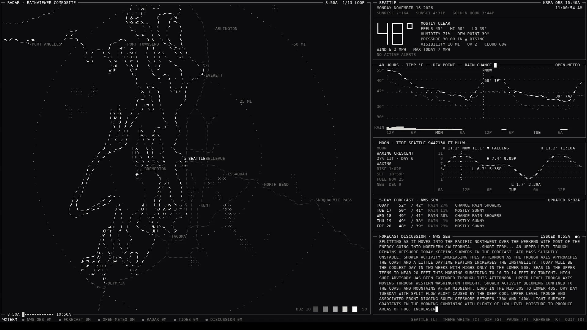
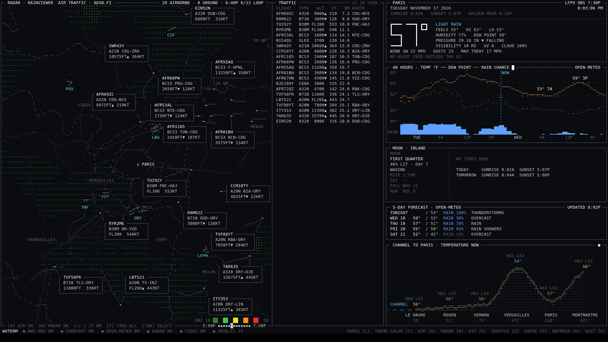

# wxterm

A low-tech, full-screen weather display for the terminal, drawn in ASCII, box-drawing characters and braille line art.
It shows a live radar loop on a map, current conditions, a 48-hour graph, tides, the moon, a 5-day forecast and the
forecast discussion, in five vintage phosphor themes. One key adds live air traffic to the map. Every data source is
free and needs no API key.

It was built for an old ThinkPad (T480, 1920x1080) running as a dedicated kiosk with no desktop. Plug it in and it boots
straight into the weather. It also runs in any big terminal window.

> **Raspberry Pi 4 / 5: early testing.** Pi support is new in 1.1 and hasn't been proven on real hardware yet.
> See [Raspberry Pi (early testing)](#raspberry-pi-early-testing) for how to install it and what's still unknown.

**Website:** [wxterm.app](https://wxterm.app)

| | |
|---|---|
|  |  |
|  |  |
|  | Each GIF is one radar loop, recorded on the kiosk with the `g` key. |

```
collectors (Docker, one per location, localhost:8091+)  ── JSON ──>  display (Python + Textual, full terminal)
  NWS · Open-Meteo · RainViewer radar · NOAA tides · METAR · sun/moon computed locally
  adsb.fi / adsb.lol aircraft · adsbdb routes (only while air traffic is on)
        └── optional MCP server (Docker, LAN :8090, token) ──> your LLM
```

## Features
- **One map, six layers.** The map (coast, borders, highways, towns, runways and airport codes) is centred on home
  with range rings, from 5 to 100 NM. The **radar loop** (`w`), live **air traffic** (`a`), **spacecraft** (`o`),
  **APRS** stations (`x`), **earthquakes** (`e`) and **wildfires** (`i`) each switch on and off on their own.
- **Air traffic** (contributed by [Justin Van Bibber](https://github.com/notjvb)): live ADS-B aircraft as arrows with
  trails and data tags, a traffic list and the selected flight's details
- **Spacecraft:** the space stations, the brightest satellites and Starlink as they cross the map, with ground
  tracks, a countdown to the next station overhead, and the stations' visible passes
- **APRS** (contributed by [Steve Miller, KC1AWV](https://github.com/kc1awv)): stations heard on APRS-IS around home,
  receive-only, with weather stations' temperatures, tracks and a heard list (needs a callsign)
- **Earthquakes and wildfires:** quakes worldwide as rings sized by magnitude (USGS and EMSC), US wildfires with their
  mapped perimeters, size and containment (NIFC), and large fires elsewhere (GDACS). Free, no keys
- **Now:** temperature in seven-segment digits, conditions, wind, pressure trend, alerts (US)
- **48 hours:** temperature and dew point lines with rain-chance bars
- **Tides and moon:** tide curve with highs and lows, plus moon phase, rise and set, and the next full and new moon
- **5-day forecast**, plus a rotating panel: the NWS forecast discussion typed out like a teletype, surf, and a
  coast-to-mountains temperature transect
- **Ten built-in locations** (your home plus nine demo cities), switched with one key
- **Five themes:** amber, green, white, IBM blue, colour
- **GIF capture** of one radar loop with one key
- **Burn-in guard** that reshuffles the layout every 15 minutes
- **Raspberry Pi 4/5** support, in early testing
- **MCP server** (optional) so an LLM can read the weather and the kiosk's status, and look at the screen

## Quick start (any Linux or macOS machine with Docker and Python 3.11+)
```bash
git clone https://github.com/jdoscher/wxterm && cd wxterm
python3 scripts/new-location.py home 47.6062 -122.3321 --title "SEATTLE"   # your own location (optional)
python3 scripts/gen-compose.py                     # docker-compose.yml from locations/order
cp .env.example .env                               # put your contact in WX_UA (the NWS asks for one)
docker compose up -d --build
cd display && python3 -m venv .venv && .venv/bin/pip install -e . && .venv/bin/wxterm
```
Use a terminal of at least 160x45. It's designed for 240x62, which is 1920x1080 with an 8x17 px cell.

### Keys
| Key | |
|---|---|
| `l` | next location (always starts on `home` after a restart) |
| `c` | next theme |
| `f` | big-digit style: segment, dots (braille LED), blocks |
| `w` | radar loop on/off |
| `a` | air traffic on/off |
| `o` | spacecraft on/off |
| `x` | APRS: all stations, weather stations only, off (when APRS is set up) |
| `e` | earthquakes on/off |
| `i` | wildfires on/off |
| `+` `-` | range: 5, 10, 15, 25, 40, 60 or 100 NM from home to the nearest edge (40 to start) |
| `g` | save a GIF of one radar loop (10 s with the radar off) to `~/gifs` |
| `s` | shuffle the layout now |
| `p` | pause the radar loop |
| `r` | refresh now |
| `q` | quit |

With air traffic on:

| Key | |
|---|---|
| `Tab` `Shift+Tab` | select the next or previous aircraft (nearest first); a click selects one too |
| `Esc` | clear the selection |
| `t` | data tags: auto, all, off |

## Kiosk setup (Debian or Ubuntu, tested on Debian 13)
```bash
sudo mkdir -p /opt/wxterm && sudo chown "$USER": /opt/wxterm
git clone https://github.com/jdoscher/wxterm /opt/wxterm && cd /opt/wxterm
cp kiosk/kiosk.conf.example kiosk/kiosk.conf && nano kiosk/kiosk.conf
python3 scripts/new-location.py home LAT LON --title "YOUR TOWN"
sudo bash kiosk/setup.sh && sudo reboot
```
`setup.sh` installs everything (cage, foot, Docker, ffmpeg and friends), starts the collectors, creates the kiosk user
that autologs into tty1, and sets the machine to boot straight into the display. It's safe to run again after you
change `kiosk.conf`. Every setting:

| Setting | Default | What it does |
|---|---|---|
| `WXTERM_DIR` | `/opt/wxterm` | where the code lives |
| `STATE_DIR` | `/var/lib/wxterm` | saved theme/location, GIFs, screenshots, display settings |
| `KIOSK_USER` | `wxterm` | account that autologs into tty1 and runs the display (created, no password) |
| `DEPLOY_USER` | the user running `sudo` | owns `WXTERM_DIR`; pushes updates with `scripts/deploy.sh` |
| `ADMIN_USERS` | none | added to the docker and kiosk groups, and given a `~/gifs` shortcut |
| `NWS_CONTACT` | none | email or URL sent to api.weather.gov, which asks clients to identify themselves |
| `START_LOCATION` | `home` | the location shown after every restart |
| `THEME` | `amber` | first-run theme; `c` changes it and the choice is saved |
| `BIGFONT` | `segment` | first-run digit style; `f` changes it |
| `AIR` | `off` | first-run air traffic: `on` or `off` (it polls the ADS-B feeds every 2.5 s while on); `a` changes it |
| `QUAKES`, `FIRES` | `on`, `on` | first-run earthquake and wildfire layers; `e` and `i` change them |
| `QUAKE_MIN_MAG` | `1.5` | smallest quake drawn for the past day (older ones from M2.5) |
| `APRS_CALL` | none | your callsign turns on APRS (receive-only); blank = off |
| `APRS_LOCATIONS`, `APRS_RANGE_KM` | first location, `150` | which collectors connect to APRS-IS, and the filter radius |
| `APRS_VIEW` | `all` | first-run APRS layer: `all`, `wx` or `off`; `x` changes it |
| `LID` | `ignore` | laptop lid in kiosk mode: `ignore`, or `suspend` to sleep when it closes and wake when it opens (on battery or power; a dock keeps it awake). The display refreshes everything on waking |
| `SHUFFLE_MIN` | `15` | burn-in shuffle interval in minutes, `0` = off |
| `GIF_FPS` | `10` | GIF frame rate |
| `FONT`, `FONT_SIZE` | `DejaVu Sans Mono`, `13` | terminal font (13 px gives 240x62 cells at 1080p) |
| `KIOSK_MODE` | `yes` | boot straight into the display after setup |
| `PROFILE` | `standard` | `pi` for a Raspberry Pi (early testing): slower animation and four locations unless `LOCATIONS` says otherwise |
| `LOCATIONS` | all (`pi`: `home sf london tokyo`) | which locations to run, by name; each is a ~70 MB collector |
| `RADAR_STEP`, `TYPE_STEP` | `0.35`, `0.15` (`pi`: `0.5`, `0.3`) | seconds per radar frame and per teletype step |
| `MCP` | `no` | `yes` runs the MCP server (below) |
| `MCP_PORT`, `MCP_BIND` | `8090`, `0.0.0.0` | where it listens: all interfaces, one LAN address, or `127.0.0.1` |
| `MCP_TOKEN` | generated | bearer token clients must send; blank = generate one and keep it in `.env` |

Day to day:
- `sudo kiosk/mode.sh desktop` (or `kiosk`) switches between the normal desktop and the kiosk, effective at the next
  boot (add `--now` to reboot right away). `mode.sh status` shows the current mode. Ctrl+Alt+F2 opens a console.
- `scripts/wxctl.sh location sf | theme green | font dots | air on | radar off | space on | range 25 | tags all |
  gif` controls the running display from SSH.
- `kiosk/capture.sh shot` saves a full-screen PNG and `capture.sh video 30` records 30 s of MP4, both to
  `STATE_DIR/captures`.
- `scripts/deploy.sh HOST --up`, run from a development checkout, pushes code to the kiosk, rebuilds and restarts
  the display.

**Burn-in guard:** every `SHUFFLE_MIN` minutes the map swaps sides, the sidebar panels reorder and the status bar moves
between top and bottom. That's 480 layouts, so no border or label stays on the same pixels for hours.

## Raspberry Pi (early testing)

> **Status: early testing.** wxterm 1.1 passes an emulated ARM64 test (Docker images build, a collector fetches
> every source, the display renders, and every package setup needs exists for arm64), but it hasn't been run for any
> length of time on a real Pi. Expect rough edges, and please
> [open an issue](https://github.com/jdoscher/wxterm/issues) with your model, OS and what happened.

**You need:** a Raspberry Pi 4 with 4 GB or more (a Pi 5 should also work), a 1080p screen on HDMI, and ideally a
USB SSD to boot from. The collectors write their cache every few minutes around the clock, which wears out SD cards.

**1. Flash the OS.** In [Raspberry Pi Imager](https://www.raspberrypi.com/software/), choose
**Raspberry Pi OS Lite (64-bit)** and your SSD (or SD card). In the settings, set a username and password, your Wi-Fi
if you're not using Ethernet, and turn on SSH. Boot the Pi with the screen plugged into the HDMI port next to the
power socket.

**2. Install wxterm.** SSH in, then:
```bash
sudo apt update && sudo apt full-upgrade -y && sudo apt install -y git
sudo mkdir -p /opt/wxterm && sudo chown "$USER": /opt/wxterm
git clone https://github.com/jdoscher/wxterm /opt/wxterm && cd /opt/wxterm
cp kiosk/kiosk.conf.example kiosk/kiosk.conf
sed -i 's/^PROFILE=standard/PROFILE=pi/' kiosk/kiosk.conf
python3 scripts/new-location.py home LAT LON --title "YOUR TOWN"
sudo bash kiosk/setup.sh && sudo reboot
```
Replace `LAT LON` with your coordinates (e.g. `47.6062 -122.3321`). `new-location.py` downloads about 100 MB of map data
once, and setup builds the Docker images on the Pi, so the first run takes a while. After the reboot it goes straight to the weather screen.

**What `PROFILE=pi` changes:** it runs four locations (home, San Francisco, London, Tokyo) instead of ten, saving
about 400 MB of memory, and animates a little slower (radar 0.5 s per frame, teletype 0.3 s per step). Pick your own
cities with `LOCATIONS="home nyc paris"` in `kiosk.conf`, then rerun `sudo bash kiosk/setup.sh`.

**Not known yet:** CPU load and temperature over days of running, how long `g` takes to encode a GIF (slower than
on a laptop), and whether a Pi 5 or a 2 GB Pi 4 needs different settings. To go back to a normal console boot:
`sudo /opt/wxterm/kiosk/mode.sh desktop --now`.

## Air traffic
Press `a` and live aircraft fly over the map, through the rain if the radar is on.

> **Hat tip:** the flight tracker is the work of [Justin Van Bibber](https://github.com/notjvb), who ported
> AsciiFlights, a flight tracker for the browser drawn in text, onto wxterm's terminal and map. Thanks, Justin.



- **Aircraft** are arrows pointing along their track, with a 90-second braille trail. Parked aircraft are dimmed, and
  emergency squawks (7500, 7600, 7700) blink. Between polls (every 2.5 s) each position is dead-reckoned from its
  speed and track, so traffic moves smoothly.
- **The map** is the same one the radar uses. With both layers on, the radar loop keeps running under the traffic,
  drawn a little lighter so the aircraft stand out, and you can see who's flying around the storms. Aircraft draw over
  map labels: where a plane is matters more than the label it covers for a moment.
- **Data tags** show callsign, type, route (or registration), altitude with climb ▲ or descent ▼, and ground speed,
  on a leader line placed so tags don't overlap. `t` cycles the modes. AUTO shows a tag on (nearly) every airborne
  aircraft while they fit; when the sky is too busy for the range, it shows only the selected one and the map's
  top border says TAGS BUSY. ALL
  shows as many as fit, and OFF shows only the selected one.
- **Beside the map**, when the panel is at least 120 columns wide: the traffic list (nearest first, ground last) and
  the selected aircraft's details, including operator, route, vertical rate, selected altitude, distance and bearing
  from home, and an altitude profile.
- **Routes** come from adsbdb by callsign, and they go stale: schedules change and callsigns get reused. A route is
  shown only if the aircraft is near the line between its endpoints and, away from both airports, heading toward
  the destination. Otherwise the details panel says the route on file doesn't fit.

The collector fetches aircraft only while air traffic is on, with at most one request a second to
adsb.fi (its limit for free use) and a 1.5 s cache, falling back to adsb.lol if adsb.fi fails. Airports and runways
come from OurAirports; `new-location.py` adds them to new locations. To add them to a location made before this
feature, run `python3 scripts/make_geo.py --add-airports locations/home.geo.json` and restart its collector. Without
them the map still works, just without runways.

## Spacecraft
The space stations, the ~150 brightest satellites and Starlink, drawn as they cross the map (`o` turns the layer on
and off; it's on unless `SPACE=off`).

- **On the map:** ◆ for a crewed station (ISS, Tiangong), ◇ for anything else, with the name and altitude and a dotted
  ground track 90 seconds behind and ahead. At orbital speed a satellite crosses a 40 NM map in about 20 seconds, so
  they come and go. Modules and ships docked to a station fold into it.
- **In the top border:** the countdown to the next station over the map (`ISS IN 2D 8H`; at 40 NM that's every day
  or three), or `ISS OVER THE MAP` while it's there.
- **In the rotating panel:** the stations' passes you can actually see from the location in the next two days: in
  sunlight, in a dark sky, at least 10° up, with the time, peak height, direction and length.

Orbits come from [CelesTrak](https://celestrak.org) as general perturbations elements, and positions are worked out
on the machine with SGP4, checked against [Skyfield](https://rhodesmill.org/skyfield/) in the tests. CelesTrak
updates each group every couple of hours and refuses repeat downloads before then, so the first location's collector
fetches each group at most every 6 hours and keeps it on disk, and the display asks only that collector. The layer
makes no other network requests.

## APRS
With a callsign in `APRS_CALL`, the home collector listens to APRS-IS around home and the map shows what it hears.
`x` cycles the layer: ALL (every station as a symbol with its callsign where it fits, 30-minute tracks behind moving
stations, stations not heard for 30 minutes dimmed), WX (APRS and CWOP weather stations' temperatures, like a surface
map) and OFF. Two rotating panels list the stations heard most recently and the nearby weather stations under the
official observation.

> **Hat tip:** APRS is the work of [Steve Miller, KC1AWV](https://github.com/kc1awv). Thanks, Steve.

- **Receive-only.** The login uses passcode -1, so APRS-IS never accepts anything from wxterm: nothing is transmitted
  or gated. APRS-IS still asks for a callsign as the login name, so APRS stays off without one.
- **One connection**, from the locations in `APRS_LOCATIONS` (default: the first one, home), with a range filter
  (`APRS_RANGE_KM`, 150 km) around home rounded to 0.1°, so your exact location stays on the machine.
- Packets are read by wxterm's own small parser (`collector/wxcollect/aprsparse.py`: positions, compressed positions,
  Mic-E, objects, items, weather, status), so the project stays MIT throughout.

## Earthquakes and wildfires
Both layers are on unless `QUAKES=off` or `FIRES=off`; `e` and `i` switch them. Every source is free and needs no key.

- **Earthquakes** come from the [USGS](https://earthquake.usgs.gov/earthquakes/feed/v1.0/geojson.php) feeds (every
  size for the past day, M2.5+ for the week, worldwide) merged with [EMSC](https://www.seismicportal.eu) (M2+
  worldwide, often first outside the US). A quake both report within a minute and 100 km is shown once, from USGS.
  On the map each is a ring sized by magnitude: bright in the first hour (with its age, `M4.2 6M AGO`), normal for the
  day and dim for the rest of the week. The day's quakes are drawn from `QUAKE_MIN_MAG` (M1.5) and older ones from
  M2.5. The top border names a new one (`M4.2 QUAKE 6M AGO`) or counts the day's.
- **Wildfires** in the US come from the National Interagency Fire Center's
  [WFIGS](https://data-nifc.opendata.arcgis.com) service: every wildfire incident (no prescribed burns) as ▲ with its
  name, acres and containment, and the mapped perimeters as hatched outlines. Fires that are fully contained and
  haven't been updated for 3 days are left off. Outside the US, [GDACS](https://www.gdacs.org) (the UN and EU global
  disaster alert system) adds the large fires it tracks, with their burnt area in hectares.
- **In the rotating panel:** the past week's earthquakes within 300 miles (newest first, with depth, distance and
  direction, and the day's largest anywhere), and a wildfire page when a fire is within 300 miles.
- **Network:** the first location's collector fetches the worldwide lists for everyone, quakes every 5 minutes and
  fires every 15, only while a display asks for them, and keeps the last good copy on disk if a source is down.

## MCP server (let an LLM read it)
With `MCP=yes` in `kiosk.conf`, setup runs a small read-only [MCP](https://modelcontextprotocol.io) server in Docker
at `http://KIOSK:8090/mcp`. Ask your assistant "is rain heading my way?", "when's the next high tide?" or "is the
kiosk running hot?", or have it look at the screen. `scripts/wxctl.sh mcp` prints the URL, the token and ready-made
client configs:

```bash
claude mcp add --transport http wxterm http://KIOSK:8090/mcp --header "Authorization: Bearer TOKEN"   # Claude Code
```
Claude Desktop and other stdio-only clients connect through `npx mcp-remote` (the exact snippet is in `wxctl.sh mcp`).

| Tool | Returns |
|---|---|
| `list_locations` | locations and which one is on screen |
| `get_current_conditions` | temperature, feels-like, high/low, wind, humidity, pressure, sun, active alert names |
| `get_forecast` | NWS text periods (US), 7-day outlook, next 0-48 hours |
| `get_radar_summary` | precipitation over the location, nearest echo distance/direction, intensity, trend, movement |
| `get_tides_moon_sun` | tide now and the next highs/lows, water temperature, moon, sun and golden hour |
| `get_alerts`, `get_forecast_discussion` | full NWS alert text and the forecaster's discussion (US) |
| `get_marine`, `get_transect` | surf and swell; temperatures from the coast inland |
| `get_hazards` | earthquakes (past week) and wildfires within a radius, with the day's largest quake anywhere |
| `get_status` | display state and layout, freshness of every data source, CPU, memory, temperatures, battery, disk |
| `screenshot` | a PNG of the screen (half or full size) |

Weather tools take an optional `location`; without one they use what's on screen. **Nothing can change the display or
the machine through MCP.** Security:
- Every request needs the bearer token. Requests with a browser `Origin` header are refused (no drive-by web pages),
  and each client IP is rate limited (120 requests a minute).
- The container is read-only, drops every capability, and sees the state folder read-only. The one exception is
  `requests/`, where it drops screenshot requests that the display answers.
- The collectors only listen on `127.0.0.1`. The MCP server reaches them over Docker's internal network.
- It's plain HTTP on your LAN: don't forward the port to the internet. For access from outside, use a VPN or an SSH
  tunnel (`MCP_BIND=127.0.0.1`, then `ssh -L 8090:localhost:8090 kiosk`). Docker-published ports bypass
  ufw and firewalld, so `MCP_BIND` is the setting that controls exposure.
- Alert and discussion text comes from weather services and is passed through as data.

## Locations
`locations/order` lists the locations in toggle order, each with the host port of its collector. A location is used
when its `locations/<name>.env` exists. `scripts/new-location.py NAME LAT LON` creates one: it looks up the timezone,
the NWS office and station (or the nearest airport METAR outside the US), the nearest NOAA tide and water-temperature
stations (or open water for model tides), surf, map labels, airports and a transect. It then writes the map lines, adds the
location to `order` and regenerates `docker-compose.yml`. `home` is gitignored, so your own location stays out of git.

| Name | Data | Notes |
|---|---|---|
| `home` | yours | made with `new-location.py home LAT LON`, never committed |
| `sf` | NWS | SFO, Golden Gate tides (Alameda water temp), Ocean Beach surf |
| `la` | NWS | LAX, Santa Monica tides and water temp, Venice surf |
| `seattle` | NWS | Sea-Tac, Seattle tides |
| `chicago` | NWS | Midway, Lake Michigan waves (no tides) |
| `nyc` | NWS | Central Park, The Battery tides, Rockaway surf |
| `london` | global | London City METAR, Thames estuary model tides |
| `paris` | global | Orly METAR, inland |
| `oslo` | global | Gardermoen METAR, Oslofjord model tides |
| `tokyo` | global | Haneda METAR, Tokyo Bay model tides, Shonan surf |

The first location in `order` polls at full rate. The others poll 4x slower and catch up within seconds when you switch
to them, which keeps ten collectors well inside Open-Meteo's free daily limit. `global` places use airport METARs and
the Open-Meteo forecast. They have no alerts or forecast discussion, which are NWS-only products, so those panels are
skipped. Every `.env` key is documented in `collector/wxcollect/config.py`.

## Data sources
| What | Source | Refresh |
|---|---|---|
| Current conditions | [NWS](https://www.weather.gov/documentation/services-web-api) station (US), [aviationweather.gov](https://aviationweather.gov/data/api/) METAR (elsewhere) | 5 min |
| Forecast, alerts, forecast discussion | NWS (US), [Open-Meteo](https://open-meteo.com) forecast (elsewhere) | 30 min / 2 min / 30 min |
| Hourly graph, transect | Open-Meteo forecast | 15-30 min |
| Surf, sea temperature, model tides | Open-Meteo marine | 30 min / 6 h |
| Radar loop (last ~2 h) | [RainViewer](https://www.rainviewer.com/api.html) composite; IEM NEXRAD as a US fallback | 5 min |
| Tides, water temperature | [NOAA CO-OPS](https://tidesandcurrents.noaa.gov/api/) | 6 h / 15 min |
| Sun, golden hour, moon | computed locally with `astral` | |
| Map lines | [Natural Earth](https://www.naturalearthdata.com) 10m (public domain) | static |
| Airports and runways | [OurAirports](https://ourairports.com/data/) (public domain) | static |
| Aircraft (air traffic) | [adsb.fi open data](https://github.com/adsbfi/opendata), [adsb.lol](https://api.adsb.lol) as a fallback | 2.5 s, only while air traffic is on |
| Flight routes | [adsbdb](https://www.adsbdb.com) | on demand, cached 6 h |
| APRS stations | [APRS-IS](https://www.aprs-is.net) (receive-only, needs a callsign) | live |
| Spacecraft orbits | [CelesTrak](https://celestrak.org/NORAD/elements/) (stations, visual, Starlink), propagated locally with [sgp4](https://pypi.org/project/sgp4/) | 6 h, one collector |
| Earthquakes | [USGS](https://earthquake.usgs.gov/earthquakes/feed/) and [EMSC](https://www.seismicportal.eu) | 5 min, one collector |
| Wildfires | [NIFC WFIGS](https://data-nifc.opendata.arcgis.com) (US incidents and perimeters), [GDACS](https://www.gdacs.org) (elsewhere) | 15 min, one collector |
| Town names (`new-location.py`) | [GeoNames](https://www.geonames.org) cities over 5,000 people (CC BY 4.0) | static |

adsb.fi's open data is free for personal, non-commercial use. RainViewer's free API serves zoom 7 at most and only
colour scheme 2, and wxterm decodes that palette back to dBZ.
Radar tiles are cached on disk, and requests back off on rate limits. Weather data © the providers above. Open-Meteo
data is CC BY 4.0.

## Development
- Tests: `pip install -r requirements-dev.txt`, then `pytest` from the repo root (about 20 s, no network: the
  collector and the feeds are faked). They cover the map's layers and air traffic from the collector's lookups
  through to the keys and what reaches the screen.
- `python -m wxterm.snap OUTDIR 240 67 [themes...]` (with `WXTERM_LOCATION=sf`) renders the screen headless to SVG
  and fails if any panel shows an error. `WXTERM_AIR=on` adds air traffic to the map.
- Collector API, per location (localhost only): `GET /api/all`, `/api/radar?w=&h=` (optional `&bbox=` and `&last=N`
  frames), `/api/geo`, `/api/aircraft?dist=NM`, `/api/routes?cs=UAL1,DAL2`, `/api/tle?group=stations`, `/api/aprs`,
  `/api/quakes`, `/api/fires`, `/api/refresh`, `/healthz`.
- MCP server: `mcp/wxmcp/` (`weather.py` turns collector JSON into summaries, `system.py` reads machine stats,
  `server.py` holds the tools and the auth guard). The display's side is `display/wxterm/remote.py`.
- Layout: `display/wxterm/app.py`. Panels: `panels.py`, and the map with its radar and air traffic layers in
  `flights.py` (with the collector side in `collector/wxcollect/flights.py`). Earthquakes and wildfires: `hazards.py`
  on both sides. Braille canvas: `canvas.py`. Themes: `themes.py`.

## License
MIT. See [LICENSE](LICENSE).
