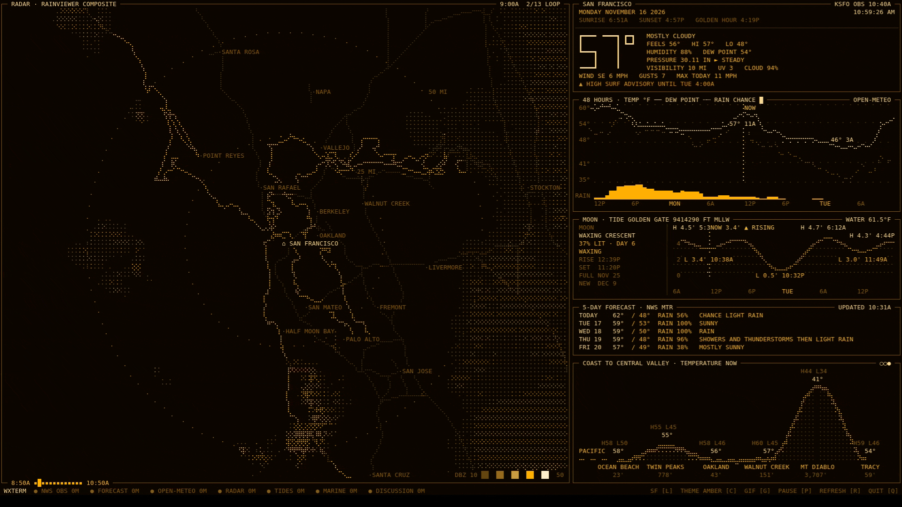
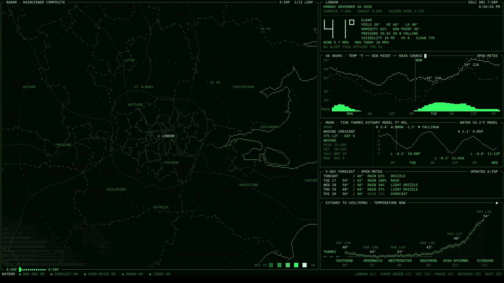
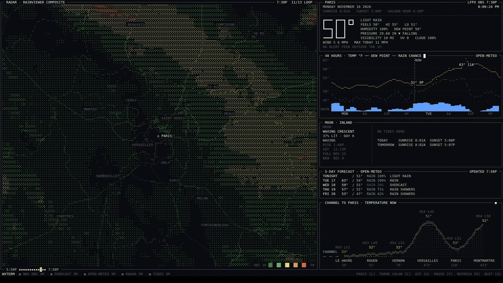
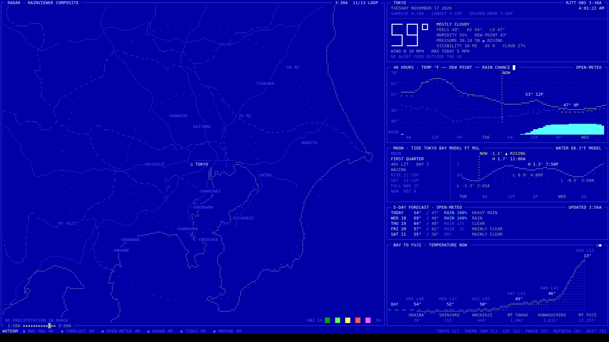

# wxterm

A low-tech, full-screen weather display for the terminal, drawn in ASCII, box-drawing characters and braille line art.
It shows a live radar loop on a map, current conditions, a 48-hour graph, tides, the moon, a 5-day forecast and the
forecast discussion, in five vintage phosphor themes. Every data source is free and needs no API key.

It was built for an old ThinkPad (T480, 1920x1080) running as a dedicated kiosk with no desktop. Plug it in and it boots
straight into the weather. It also runs in any big terminal window.

**Website:** [wxterm.app](https://wxterm.app)

| | |
|---|---|
|  |  |
|  |  |
|  | Each GIF is one radar loop, recorded on the kiosk with the `g` key. |

```
collectors (Docker, one per location, localhost:8091+)  ── JSON ──>  display (Python + Textual, full terminal)
  NWS · Open-Meteo · RainViewer radar · NOAA tides · METAR · sun/moon computed locally
        └── optional MCP server (Docker, LAN :8090, token) ──> your LLM
```

## Features
- **Radar loop** over a line-drawn map (coast, borders, highways, towns), with 25/50-mile rings and a dBZ legend
- **Now:** temperature in seven-segment digits, conditions, wind, pressure trend, alerts (US)
- **48 hours:** temperature and dew point lines with rain-chance bars
- **Tides and moon:** tide curve with highs and lows, plus moon phase, rise and set, and the next full and new moon
- **5-day forecast**, plus a rotating panel: the NWS forecast discussion typed out like a teletype, surf, and a
  coast-to-mountains temperature transect
- **Ten built-in locations** (your home plus nine demo cities), switched with one key
- **Five themes:** amber, green, white, IBM blue, colour
- **GIF capture** of one radar loop with one key
- **Burn-in guard** that reshuffles the layout every 15 minutes
- **MCP server** (optional) so an LLM can read the weather and the kiosk's status, and look at the screen

## Quick start (any Linux or macOS machine with Docker and Python 3.11+)
```bash
git clone https://github.com/jdoscher/wxterm && cd wxterm
python3 scripts/new-location.py home 47.6062 -122.3321 --title "SEATTLE"   # your own location (optional)
python3 scripts/gen-compose.py                     # docker-compose.yml from locations/order
cp .env.example .env                               # put your contact in WX_UA (the NWS asks for one)
docker compose up -d --build
cd display && python3 -m venv .venv && .venv/bin/pip install -e . && .venv/bin/wxterm
```
Use a terminal of at least 160x45. It's designed for 240x62, which is 1920x1080 with an 8x17 px cell.

### Keys
| Key | |
|---|---|
| `l` | next location (always starts on `home` after a restart) |
| `c` | next theme |
| `f` | big-digit style: segment, dots (braille LED), blocks |
| `g` | save a GIF of one radar loop to `~/gifs` |
| `s` | shuffle the layout now |
| `p` | pause the radar loop |
| `r` | refresh now |
| `q` | quit |

## Kiosk setup (Debian or Ubuntu, tested on Debian 13)
```bash
sudo git clone https://github.com/jdoscher/wxterm /opt/wxterm && cd /opt/wxterm
cp kiosk/kiosk.conf.example kiosk/kiosk.conf && nano kiosk/kiosk.conf
python3 scripts/new-location.py home LAT LON --title "YOUR TOWN"
sudo bash kiosk/setup.sh && sudo reboot
```
`setup.sh` installs everything (cage, foot, Docker, ffmpeg and friends), starts the collectors, creates the kiosk user
that autologs into tty1, and sets the machine to boot straight into the display. It's safe to run again after you
change `kiosk.conf`. Every setting:

| Setting | Default | What it does |
|---|---|---|
| `WXTERM_DIR` | `/opt/wxterm` | where the code lives |
| `STATE_DIR` | `/var/lib/wxterm` | saved theme/location, GIFs, screenshots, display settings |
| `KIOSK_USER` | `wxterm` | account that autologs into tty1 and runs the display (created, no password) |
| `DEPLOY_USER` | the user running `sudo` | owns `WXTERM_DIR`; pushes updates with `scripts/deploy.sh` |
| `ADMIN_USERS` | none | added to the docker and kiosk groups, and given a `~/gifs` shortcut |
| `NWS_CONTACT` | none | email or URL sent to api.weather.gov, which asks clients to identify themselves |
| `START_LOCATION` | `home` | the location shown after every restart |
| `THEME` | `amber` | first-run theme; `c` changes it and the choice is saved |
| `BIGFONT` | `segment` | first-run digit style; `f` changes it |
| `SHUFFLE_MIN` | `15` | burn-in shuffle interval in minutes, `0` = off |
| `GIF_FPS` | `10` | GIF frame rate |
| `FONT`, `FONT_SIZE` | `DejaVu Sans Mono`, `13` | terminal font (13 px gives 240x62 cells at 1080p) |
| `KIOSK_MODE` | `yes` | boot straight into the display after setup |
| `MCP` | `no` | `yes` runs the MCP server (below) |
| `MCP_PORT`, `MCP_BIND` | `8090`, `0.0.0.0` | where it listens: all interfaces, one LAN address, or `127.0.0.1` |
| `MCP_TOKEN` | generated | bearer token clients must send; blank = generate one and keep it in `.env` |

Day to day:
- `sudo kiosk/mode.sh desktop` (or `kiosk`) switches between the normal desktop and the kiosk, effective at the next
  boot (add `--now` to reboot right away). `mode.sh status` shows the current mode. Ctrl+Alt+F2 opens a console.
- `scripts/wxctl.sh location sf | theme green | font dots | gif` controls the running display from SSH.
- `kiosk/capture.sh shot` saves a full-screen PNG and `capture.sh video 30` records 30 s of MP4, both to
  `STATE_DIR/captures`.
- `scripts/deploy.sh HOST --up`, run from a development checkout, pushes code to the kiosk, rebuilds and restarts
  the display.

**Burn-in guard:** every `SHUFFLE_MIN` minutes the map swaps sides, the sidebar panels reorder and the status bar moves
between top and bottom. That's 480 layouts, so no border or label stays on the same pixels for hours.

## MCP server (let an LLM read it)
With `MCP=yes` in `kiosk.conf`, setup runs a small read-only [MCP](https://modelcontextprotocol.io) server in Docker
at `http://KIOSK:8090/mcp`. Ask your assistant "is rain heading my way?", "when's the next high tide?" or "is the
kiosk running hot?", or have it look at the screen. `scripts/wxctl.sh mcp` prints the URL, the token and ready-made
client configs:

```bash
claude mcp add --transport http wxterm http://KIOSK:8090/mcp --header "Authorization: Bearer TOKEN"   # Claude Code
```
Claude Desktop and other stdio-only clients connect through `npx mcp-remote` (the exact snippet is in `wxctl.sh mcp`).

| Tool | Returns |
|---|---|
| `list_locations` | locations and which one is on screen |
| `get_current_conditions` | temperature, feels-like, high/low, wind, humidity, pressure, sun, active alert names |
| `get_forecast` | NWS text periods (US), 7-day outlook, next 0-48 hours |
| `get_radar_summary` | precipitation over the location, nearest echo distance/direction, intensity, trend, movement |
| `get_tides_moon_sun` | tide now and the next highs/lows, water temperature, moon, sun and golden hour |
| `get_alerts`, `get_forecast_discussion` | full NWS alert text and the forecaster's discussion (US) |
| `get_marine`, `get_transect` | surf and swell; temperatures from the coast inland |
| `get_status` | display state and layout, freshness of every data source, CPU, memory, temperatures, battery, disk |
| `screenshot` | a PNG of the screen (half or full size) |

Weather tools take an optional `location`; without one they use what's on screen. **Nothing can change the display or
the machine through MCP.** Security:
- Every request needs the bearer token. Requests with a browser `Origin` header are refused (no drive-by web pages),
  and each client IP is rate limited (120 requests a minute).
- The container is read-only, drops every capability, and sees the state folder read-only. The one exception is
  `requests/`, where it drops screenshot requests that the display answers.
- The collectors only listen on `127.0.0.1`. The MCP server reaches them over Docker's internal network.
- It's plain HTTP on your LAN: don't forward the port to the internet. For access from outside, use a VPN or an SSH
  tunnel (`MCP_BIND=127.0.0.1`, then `ssh -L 8090:localhost:8090 kiosk`). Docker-published ports bypass
  ufw and firewalld, so `MCP_BIND` is the setting that controls exposure.
- Alert and discussion text comes from weather services and is passed through as data.

## Locations
`locations/order` lists the locations in toggle order, each with the host port of its collector. A location is used
when its `locations/<name>.env` exists. `scripts/new-location.py NAME LAT LON` creates one: it looks up the timezone,
the NWS office and station (or the nearest airport METAR outside the US), the nearest NOAA tide and water-temperature
stations (or open water for model tides), surf, map labels and a transect. It then writes the map lines, adds the
location to `order` and regenerates `docker-compose.yml`. `home` is gitignored, so your own location stays out of git.

| Name | Data | Notes |
|---|---|---|
| `home` | yours | made with `new-location.py home LAT LON`, never committed |
| `sf` | NWS | SFO, Golden Gate tides (Alameda water temp), Ocean Beach surf |
| `la` | NWS | LAX, Santa Monica tides and water temp, Venice surf |
| `seattle` | NWS | Sea-Tac, Seattle tides |
| `chicago` | NWS | Midway, Lake Michigan waves (no tides) |
| `nyc` | NWS | Central Park, The Battery tides, Rockaway surf |
| `london` | global | London City METAR, Thames estuary model tides |
| `paris` | global | Orly METAR, inland |
| `oslo` | global | Gardermoen METAR, Oslofjord model tides |
| `tokyo` | global | Haneda METAR, Tokyo Bay model tides, Shonan surf |

The first location in `order` polls at full rate. The others poll 4x slower and catch up within seconds when you switch
to them, which keeps ten collectors well inside Open-Meteo's free daily limit. `global` places use airport METARs and
the Open-Meteo forecast. They have no alerts or forecast discussion, which are NWS-only products, so those panels are
skipped. Every `.env` key is documented in `collector/wxcollect/config.py`.

## Data sources
| What | Source | Refresh |
|---|---|---|
| Current conditions | [NWS](https://www.weather.gov/documentation/services-web-api) station (US), [aviationweather.gov](https://aviationweather.gov/data/api/) METAR (elsewhere) | 5 min |
| Forecast, alerts, forecast discussion | NWS (US), [Open-Meteo](https://open-meteo.com) forecast (elsewhere) | 30 min / 2 min / 30 min |
| Hourly graph, transect | Open-Meteo forecast | 15-30 min |
| Surf, sea temperature, model tides | Open-Meteo marine | 30 min / 6 h |
| Radar loop (last ~2 h) | [RainViewer](https://www.rainviewer.com/api.html) composite; IEM NEXRAD as a US fallback | 5 min |
| Tides, water temperature | [NOAA CO-OPS](https://tidesandcurrents.noaa.gov/api/) | 6 h / 15 min |
| Sun, golden hour, moon | computed locally with `astral` | |
| Map lines | [Natural Earth](https://www.naturalearthdata.com) 10m (public domain) | static |
| Town names (`new-location.py`) | [GeoNames](https://www.geonames.org) cities over 5,000 people (CC BY 4.0) | static |

RainViewer's free API serves zoom 7 at most and only colour scheme 2, and wxterm decodes that palette back to dBZ.
Radar tiles are cached on disk, and requests back off on rate limits. Weather data © the providers above. Open-Meteo
data is CC BY 4.0.

## Development
- `python -m wxterm.snap OUTDIR 240 67 [themes...]` (with `WXTERM_LOCATION=sf`) renders the screen headless to SVG
  and fails if any panel shows an error.
- Collector API, per location (localhost only): `GET /api/all`, `/api/radar?w=&h=`, `/api/geo`, `/api/refresh`,
  `/healthz`.
- MCP server: `mcp/wxmcp/` (`weather.py` turns collector JSON into summaries, `system.py` reads machine stats,
  `server.py` holds the tools and the auth guard). The display's side is `display/wxterm/remote.py`.
- Layout: `display/wxterm/app.py`. Panels: `panels.py`. Braille canvas: `canvas.py`. Themes: `themes.py`.

## License
MIT. See [LICENSE](LICENSE).
